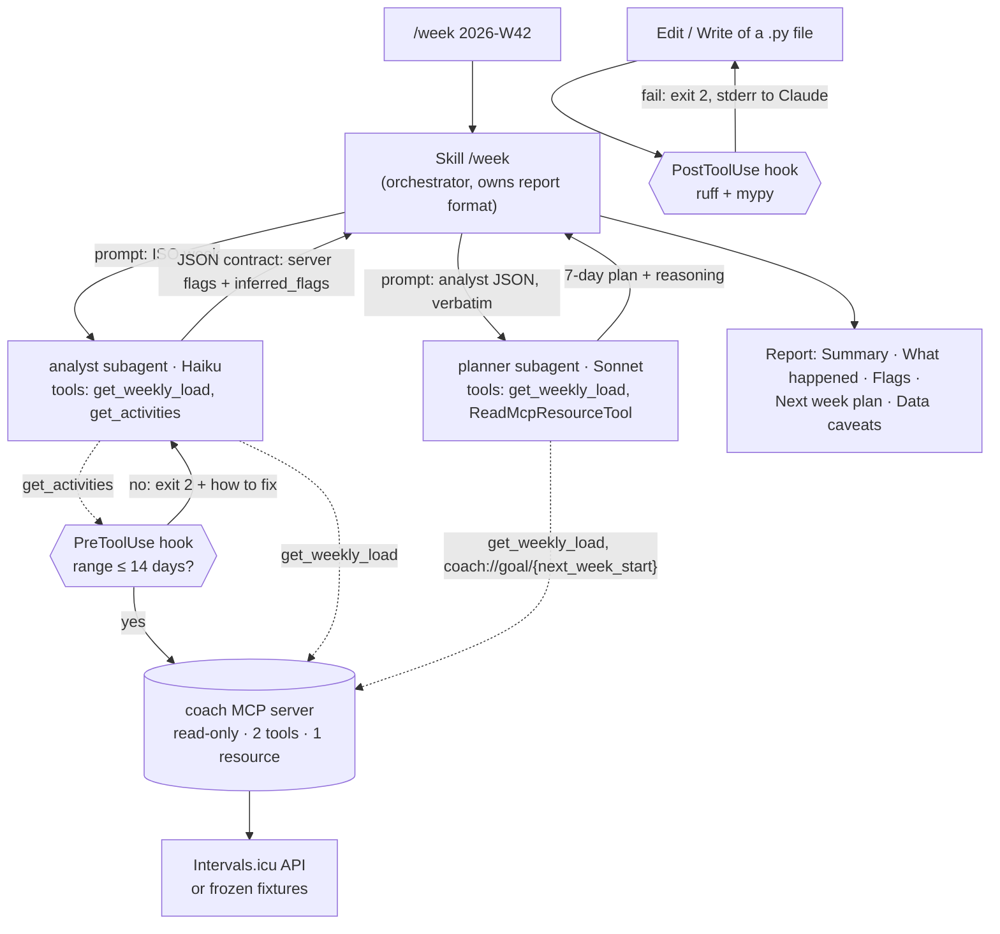

# coach

A deliberately small, read-only MCP server plus a two-subagent Claude Code workflow that
reviews my running week and plans the next one. Two tools, one resource, all maths done in
code. Built while preparing for the Claude Certified Architect – Foundations exam.

> **Why so small?** I have built large MCP servers before and watched agents get lost choosing
> between dozens of tools. This repo explores the opposite: the fewest pieces that still answer
> "how was my week?" and "what should next week look like?".

## Every piece in one sentence

| Piece | What it does |
|---|---|
| `get_activities` (tool) | Lists individual runs in a date range (max 31 days). |
| `get_weekly_load` (tool) | Returns weekly totals, trend, deterministic flags and next week's km ceiling, so the model never adds up or thresholds anything itself. |
| `coach://goal` (resource) | Exposes the target race; it is static data, so it is a resource, not a tool. |
| `coach://goal/{as_of}` (resource template) | Same race, with `days_to_race` counted in code from the Monday of the planned week. |
| `sources.py` | Hides *where* data comes from (live API or frozen fixtures) behind one `Protocol`. |
| `analytics.py` | Pure functions: every number, flag and ceiling the agent sees is computed and tested here. |
| `models.py` | Frozen Pydantic V2 models with units in every field name. |
| `data/fixtures.json` | My real runs, frozen, so tests and evals are reproducible offline. |
| `.claude/agents/analyst.md` | Subagent (Haiku) that reads one week with 2 tools, copies the server's flags and returns a fixed JSON contract. |
| `.claude/agents/planner.md` | Subagent (Sonnet) that turns the analyst JSON and the race goal into a 7-day plan under the computed ceiling. |
| `.claude/skills/week/SKILL.md` | The `/week` command: runs analyst → planner and owns the report format. |
| `.claude/hooks/limit_activity_range.py` | PreToolUse hook that blocks `get_activities` calls over 14 days. |
| `.claude/hooks/check_python.py` | PostToolUse hook that runs ruff and mypy after every `.py` edit and reports failures to Claude. |
| `.claude/settings.json` | Wires the hooks, pre-approves the two read-only tools and denies reading `.env`. |
| `evals/` | Four `/week` cases run headless, with expected behaviour and saved reports. |
| `docs/overview.md` | Two-page overview (source of `docs/coach-overview.pdf`). |
| `ROADMAP.md` | Ideas left out on purpose. |

## How `/week` flows



## Example report (real data, 2026-W42)

Output of `claude -p "/week 2026-W42"` against `data/fixtures.json`
(saved in [`evals/results/case2_2026-W42.md`](evals/results/case2_2026-W42.md)):

> # Training week 2026-W42
>
> ## Summary
> W42 was a race week: a short shakeout and then a 22 km run named "Bilbao Night Half Marathon", after one week at 0 km and one at 2.8 km. Next week is for recovery, with only short, easy runs while you rebuild your base.
>
> ## What happened
> | Metric | Value |
> |---|---|
> | Distance | 24.8 km |
> | Runs | 2 |
> | Longest run | 22 km |
> | Change vs prior weeks' average | 481.3 % |
> | Consecutive 0 km weeks | 0 |
> | Next week's ceiling (computed) | 9.4 km |
>
> Two runs: a 2.8 km Shakeout on 2026-10-13 and a 22 km run named 'Bilbao Night Half Marathon' on 2026-10-17, which matches the race name pattern. Heart rate is missing for both runs (missing_heart_rate: 2), so no HR values are reported. The week follows W41 with 0 km and W40 with 2.8 km, and the change figure is relative to the prior weeks' average as returned by the tool.
>
> ## Flags
> - **load_spike**: this week's distance was far above your recent weekly average (here +481.3 %), which raises the risk of injury.
> - **missing_hr**: at least one run has no heart-rate data.
> - **race_detected** (inferred from the run name): the 22 km run on 2026-10-17 looks like a race ("Bilbao Night Half Marathon").
>
> ## Next week plan
> Week starting 2026-10-19:
>
> | Day | Session | Approx. km |
> |---|---|---|
> | Mon | Rest | 0 |
> | Tue | Easy, conversational run | 3 |
> | Wed | Rest | 0 |
> | Thu | Easy, conversational run | 3 |
> | Fri | Rest | 0 |
> | Sat | Easy, conversational run, flat and relaxed | 3 |
> | Sun | Rest | 0 |
>
> Reasoning: The code-computed ceiling for next week is `suggested_max_next_week_km` = 9.4 km, and this plan totals about 9 km. W42 has a `load_spike` flag and a detected race (the Bilbao Night Half Marathon), so this is a recovery week. All runs are easy with no long run and no intensity. Heart rate is missing, so effort should be judged by feel: you should be able to hold a conversation throughout. With the Maratón de Madrid 188 days away (counted from 2026-10-19), there is plenty of time to rebuild a base gradually, and nothing is gained by adding load right after the half marathon.
>
> ## Data caveats
> - Heart rate is missing for both runs, so effort and intensity can't be checked.
> - The +481.3 % change is measured against a very low baseline (0 km in W41, 2.8 km in W40), so the percentage looks bigger than the actual jump in km.
>
> ---
> *Not medical or coaching advice.*

## Evals

Four cases, defined in [`evals/cases.md`](evals/cases.md). `evals/run_evals.sh` runs each one
headless (`claude -p "/week <week>"` with `COACH_FIXTURES_PATH` pointing at its fixture),
saves the report to `evals/results/`, and greps the deterministic markers. I then reviewed
every report by hand against the expected behaviour.

| # | Week | Data | Expected | Markers | Review | Result |
|---|---|---|---|---|---|---|
| 1 | 2026-W38 | real | Low irregular volume stated calmly; null % change explained; plan ≤ 9.1 km | PASS | `missing_hr` only, no alarm words, weeks named by label, plan ≈ 9 km, 216 days from 2026-09-21 | **PASS** |
| 2 | 2026-W42 | real | Spike (server) + race (inferred, labelled); recovery week ≤ 9.4 km | PASS | `race_detected` marked as inferred, plan ≈ 9 km all easy, 188 days from 2026-10-19 | **PASS** |
| 3 | 2026-W45 | real | `layoff`, question about the cause, return ≤ 6.2 km | PASS | question asked first, plan ≈ 6 km, "week in progress" caveat, 167 days from 2026-11-09 | **PASS** |
| 4 | 2026-W30 | **synthetic** | Normal build: no flags, plan ≤ 38.5 km, long run kept | PASS | no flags, plan ≈ 37 km, long run 14 km, 272 days from 2026-07-27 | **PASS** |

**What the evals caught on the way to 4/4** (fixed in code or prompts, never in the tests):

- *Code bug (case 3).* The planner asked `get_weekly_load` for 8 weeks and got a 5.7 km
  ceiling while the analyst had 6.2 km: the trend depended on the caller's `n_weeks`. Fixed
  with a fixed `trend_window_weeks=4` and a regression test.
- *Prompt (case 1).* The analyst counted weeks itself ("four weeks at 0 km", there were
  three). Now it names weeks by their labels; the planner got the same rule.
- *Prompt (cases 1 and 3).* The orchestrator claimed a subagent "did not call" a tool. It
  cannot see subagent tool calls, so the skill now forbids that claim.

> **Case 4 uses synthetic data.** `evals/synthetic/build_week.json` is invented (four weeks of
> 30, 32, 33 and 35 km with heart rate) to cover the "everything is normal" path, which my
> real data does not have. Cases 1–3 use my real runs in `data/fixtures.json`.

Caveat from case 1: the fixture starts on 2026-09-15, so the agent reads the earlier weeks as
0 km and calls W38 "a return to running". That is what the data says, not what happened;
see `ROADMAP.md`.

## Hooks and permissions

Rules that must always hold live in code that runs on every call, not in prompts.

- **PreToolUse, `mcp__coach__get_activities`**: blocks (exit 2) any range over 14 days, with a
  message that says how to fix the call.
- **PostToolUse, `Edit|Write`**: after any `.py` edit, runs `uv run ruff check` and
  `uv run mypy src`; on failure it exits 2 and Claude sees the errors and fixes them.
- **`permissions.deny: Read(./.env)`**: the agent cannot open the file that holds the API key.
  (The rule covers the Read tool; it does not stop a shell command such as `cat`.)

**Server limit (31 days) vs hook limit (14 days).** They answer different questions. The
server validates that a request is *valid*: anything up to 31 days is a correct call and the
server will answer it, for any client. The hook is a *client policy* of this Claude Code
setup: a 31-day list of runs is valid but would flood the agent's context, so this client
refuses anything over 14 days and points to `get_weekly_load` for longer trends. The server
stays general; the client is stricter for its own reasons.

Both hooks were tested with a passing and a failing case, standalone and inside a live
`claude -p` session (the PreToolUse hook stopped a 31-day call before it reached the server;
the PostToolUse hook made Claude remove an unused import and add type hints).

## Design decisions

- **Arithmetic in code, judgement in the model.** Load, pace, weekly change, zero-week
  streaks, the flags (`load_spike`, `layoff`, `incomplete_data`, `missing_hr`) and next
  week's km ceiling are computed in `analytics.py`, with thresholds in `config.py`
  (`spike_threshold_pct=30`, `layoff_min_zero_weeks=2`, `max_weekly_increase_pct=10`).
  The LLM interprets; it does not calculate or pick thresholds. The only model-made flag is
  `race_detected` (a guess from the run name), and it travels in a separate
  `inferred_flags` list so the report marks it as an inference.
- **The next-week ceiling rule.** Recent average = mean km of the returned weeks. Normal
  week: max(recent average, target week) × 1.10. After a spike or a layoff: the recent
  average, no increase. Incomplete data: no ceiling (`null`). The `max()` is there because a
  plain "average × 1.10" would cap W38 (8.3 km after three empty weeks) at 2.3 km, below the
  week the runner just ran.
- **`days_to_race` from the planned week, in code.** `get_weekly_load` returns
  `next_week_start`, and the planner reads `coach://goal/<next_week_start>`. The countdown
  is computed by the server; the model only copies a date string.
- **Read-only by construction.** The server only exposes GET calls and every tool is annotated
  `readOnlyHint=true`. Safety does not depend on a prompt.
- **Actionable errors.** A bad request returns `isError` with a message that tells the agent how
  to fix it (e.g. "Range is 152 days; max is 31. Narrow it, or use get_weekly_load").
- **Missing data is explicit.** I run without a heart-rate sensor, so HR is `null` and
  `missing_heart_rate` counts it. Load is estimated from pace instead (rTSS-like: one hour at
  threshold pace = 100).
- **Why two subagents: context isolation.** The analyst's raw tool output (weekly summaries,
  every run) stays in its own context window; the planner only sees a compact JSON. Each one
  also gets the model it needs: Haiku for extraction, Sonnet for planning.
- **Why tool allowlists.** A subagent without a `tools` field inherits every tool, Bash and
  Write included. The analyst gets exactly two read-only tools; the planner gets one tool and
  the resource reader. Least privilege is declared, not hoped for.
- **Why hooks and not prompts for guarantees.** A prompt is a request the model usually
  follows; a hook is code the harness runs on every call. The 14-day limit and the lint/type
  checks must hold every time, so they are hooks.
- **Why the hand-off is a JSON with a contract.** Subagents share no memory. A fixed set of
  keys makes the hand-off explicit, checkable by the orchestrator and easy to test, and keeps
  numbers copied from the server instead of retold in prose.
- **Why the report format lives in the skill.** Progressive disclosure: it loads only when
  `/week` runs, instead of sitting in `CLAUDE.md` in every session.
- **How the planner reads the goal.** Subagents can read MCP resources through the built-in
  `ReadMcpResourceTool`, so it is in the planner's allowlist. If that ever fails, the planner
  accepts a `goal` object pasted in its prompt by the orchestrator.

## Known limitation: Strava

Intervals.icu does not expose Strava-synced activities through its API (Strava's terms forbid
re-distribution). Those come back as stubs with a `_note` field and no distance or time.

The server does not fail the whole request because of them, and it never lets them look like
rest days:

- `get_activities` returns the readable runs as usual, plus a `blocked` list (id, date and a
  reason explaining how to fix it) for the activities that exist but cannot be read.
- `get_weekly_load` reports `blocked_activities` per week (if > 0, that week's totals
  undercount) and `data_complete: false` when any returned week has one. In that case
  `change_vs_prior_avg_pct` is `null`, and a week with blocked activities breaks the
  `zero_weeks_streak`, so a blocked half marathon never shows up as a 0 km week.

Fix: import your Strava archive into Intervals.icu once, instead of syncing from Strava.

## Run it

```bash
uv sync
cp .env.example .env          # add your Intervals.icu API key, or use fixtures mode
uv run pytest                 # 15 tests, fully offline
```

With Claude Code, open the folder: `.mcp.json` registers the server automatically (project scope).
Accept the workspace trust dialog once: until then Claude Code ignores the project's
`permissions.allow` rules (deny rules and hooks still apply).

Offline demo without any account:

```bash
COACH_FIXTURES_PATH=data/fixtures.json claude
> /week 2026-W42
```

Evals and the PDF overview:

```bash
evals/run_evals.sh                                   # all cases, or: evals/run_evals.sh 2
uv run --with markdown-pdf python docs/build_pdf.py  # builds and checks docs/coach-overview.pdf
```

## Stack

Python 3.12 · MCP Python SDK v2 (`MCPServer`) · Pydantic V2 · httpx · pytest · ruff · mypy --strict ·
Claude Code subagents, skills and hooks

---
*Not medical or coaching advice. It is a learning project about agent architecture.*
